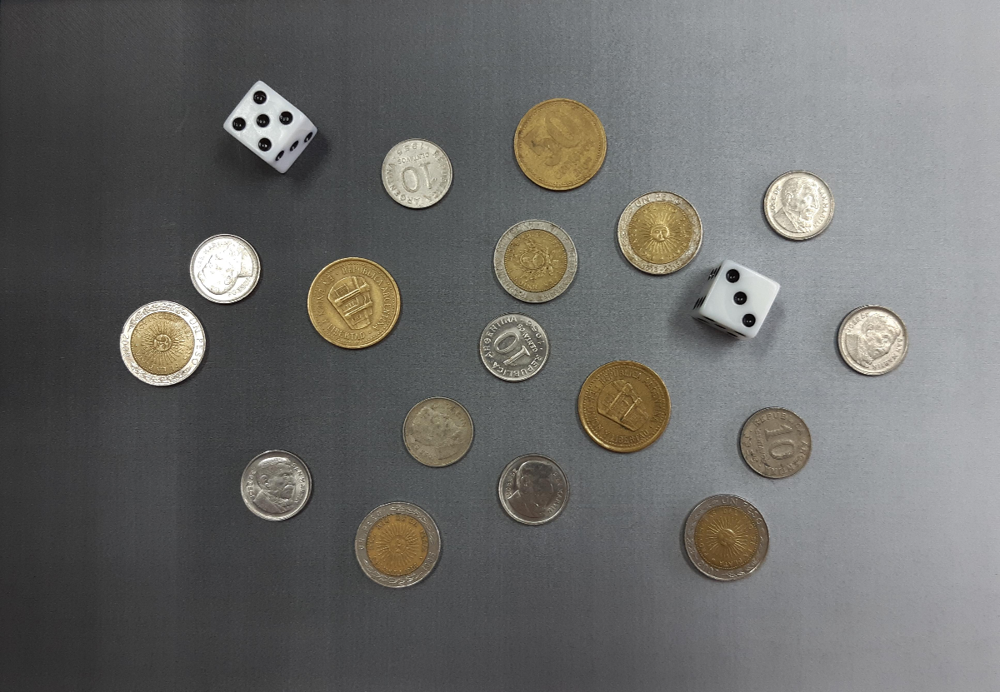
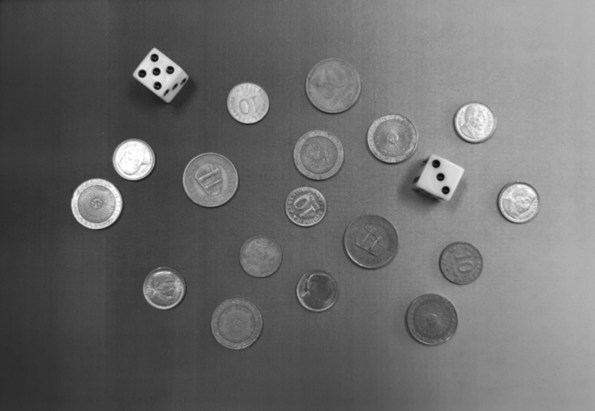
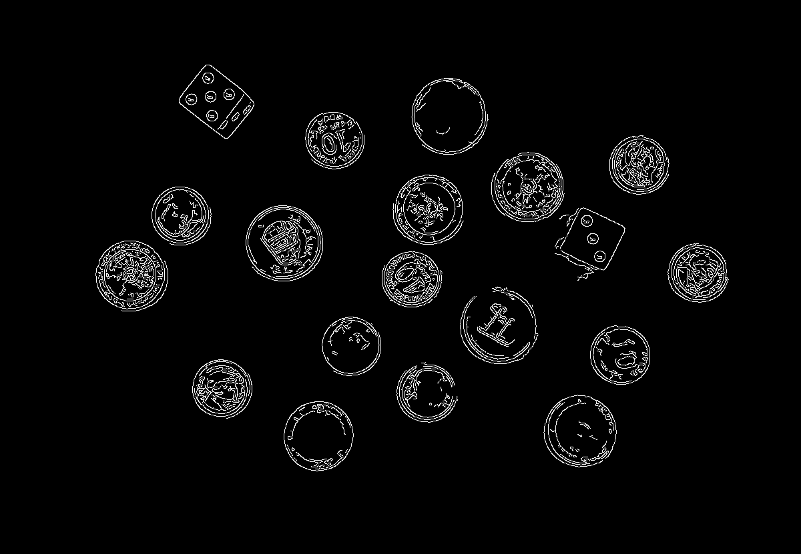
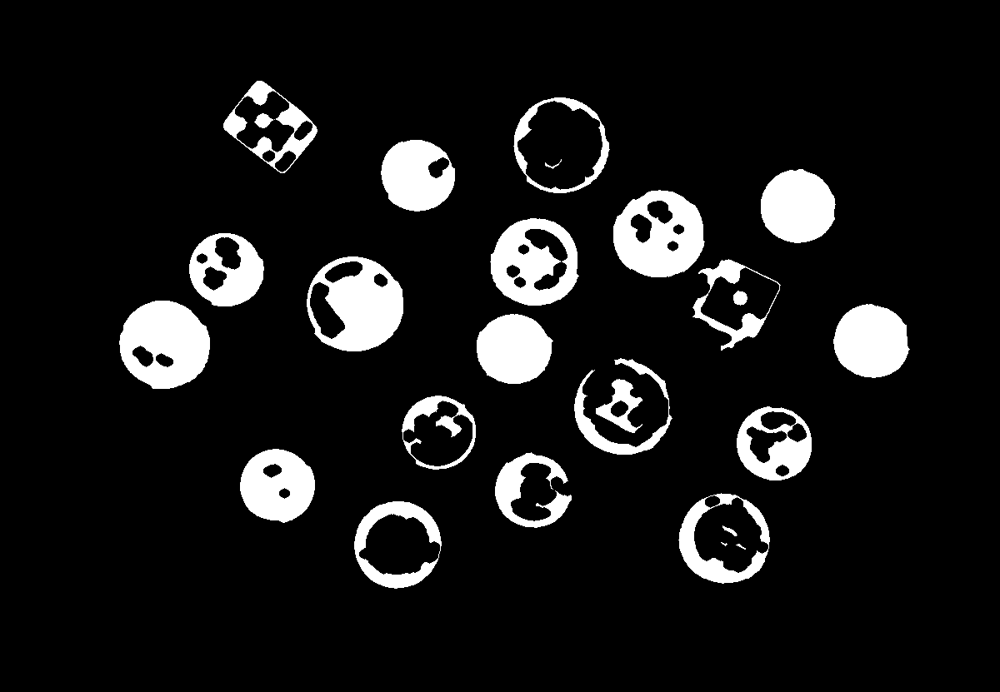
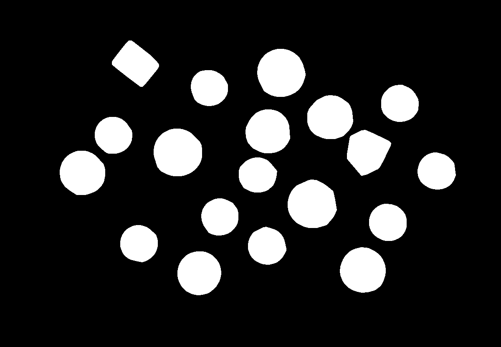
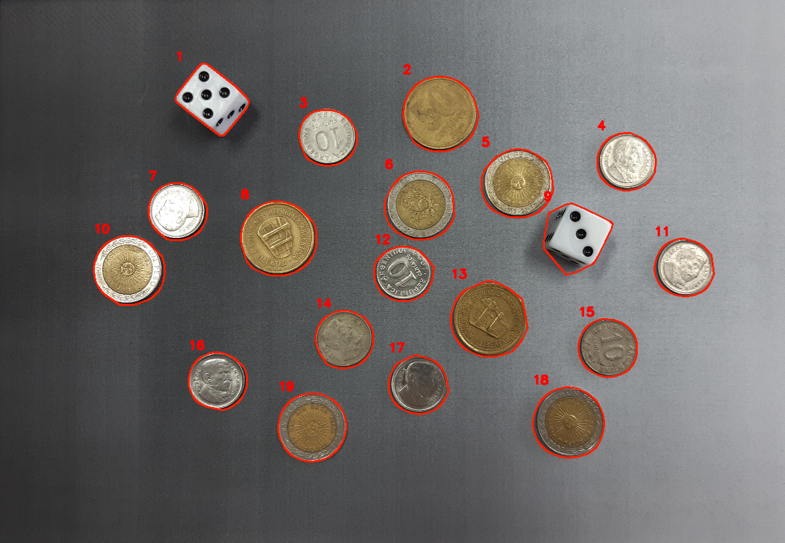

# Trabajo práctico 2

## Informe parcial: ejercicio 1.a

**Universidad Nacional de Rosario**  
Facultad de Ciencias Exactas, Ingeniería y Agrimensura  
Tecnicatura Universitaria en Inteligencia Artificial  
Procesamiento de Imágenes I · 2026

**Grupo 10:** Tomas Colombo, Franco Cerana, Juan manuel Ayala y Manuel Ibarbia.

## Alcance

Se presenta la segmentación automática de las monedas y los dados de la imagen provista. Esta entrega parcial cubre exclusivamente el punto 1.a; la clasificación de monedas, la lectura de dados y el problema de patentes quedan pendientes.

## Problema y dificultades

El fondo presenta un gradiente de iluminación. Las monedas tienen intensidades y texturas variadas, algunas próximas a las del fondo; los dados contienen puntos oscuros y caras laterales con sombras. Un único umbral global de intensidad no representa bien toda la escena. Se priorizaron los bordes y el tamaño de las regiones en la escala de trabajo.

*Figura 1. Imagen de entrada redimensionada para procesar.*

## Procedimiento

### 1. Preparación

Se reduce la imagen de 3871 × 2681 a 1200 × 831 píxeles con interpolación lineal, se convierte a grises y se aplica un filtro gaussiano de 5 × 5 para reducir ruido fino.

*Figura 2. Escala de grises suavizada.*

### 2. Detección de bordes

Canny utiliza umbrales 40 y 100. El resultado conserva también detalles internos, reflejos y textura; por sí solo no constituye una máscara de objetos.

*Figura 3. Bordes obtenidos mediante Canny.*

### 3. Cierre morfológico y selección

Se aplica dos veces un cierre con elemento elíptico de 7 × 7 para conectar discontinuidades cercanas. Se recuperan contornos externos y se seleccionan aquellos con área entre 2000 y 15000 píxeles cuadrados, en la escala de 1200 píxeles de ancho.

*Figura 4. Bordes tras el cierre morfológico.*

### 4. Máscara

Se rellena la envolvente convexa de cada contorno seleccionado. Esto completa partes faltantes, pero puede incluir fondo o perder zonas con bordes débiles; la máscara es una aproximación, no una segmentación exacta a nivel de píxel.

*Figura 5. Máscara binaria de las regiones seleccionadas.*

## Resultados y conclusiones

*Figura 6. Regiones segmentadas y numeradas sobre la entrada.*

En la imagen suministrada se obtuvieron **19 regiones**; la inspección visual identifica 17 monedas y 2 dados. El número de región es solo un identificador y no representa una clasificación. Los objetos están separados en esta escena, lo que facilita el filtrado de contornos.

La envolvente recupera contornos incompletos, aunque en particular la moneda oscura inferior y un lateral del dado derecho presentan diferencias visibles respecto del borde real. No se calculó una métrica de precisión por píxel ni se dispone de una máscara de referencia. Los parámetros se ajustaron a esta imagen y no se validaron en otras condiciones de iluminación, escala u objetos superpuestos.
